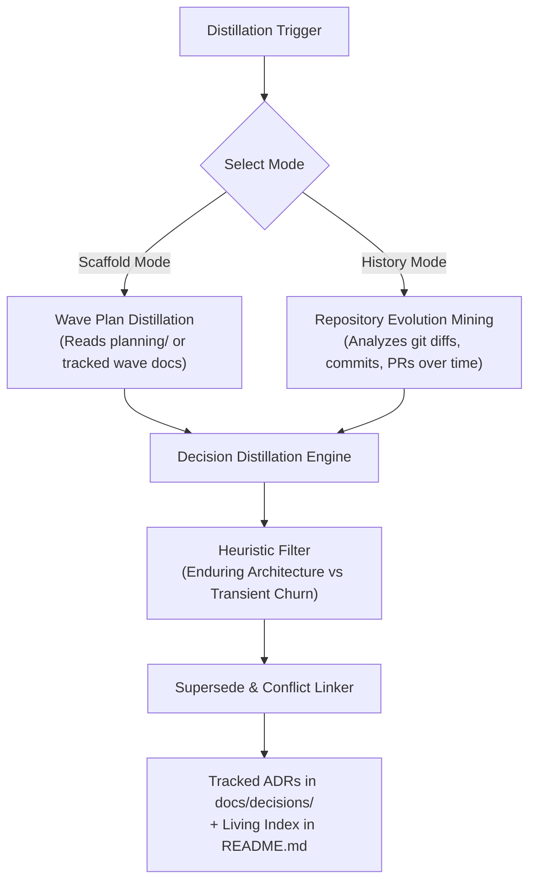

# Research Report: ADR Distillation Skill for Wave Orchestration

## Executive Summary

This research investigates the design and specification of a new skill for `aigb-skills-usda`—tentatively named `adr-distillation` (or `wave-to-adr` / `adr-manager`). The skill extracts enduring architectural decisions from wave orchestration artifacts (`planning/` directory, `EXECUTION_PLAN_N.md`, `STATE_N.md`, task micro-plans, and task completion logs) and formalizes them into standard Architecture Decision Records (ADRs).

By bridging the gap between transient execution plans and persistent system architecture, this skill ensures that architectural rationale is preserved in version control across agent sessions and repository lifecycles.

---

## 1. Analysis of Existing Planning Conventions & Wave Orchestration

### 1.1 The Wave Planning Artifact Lifecycle
In `aigb-skills-usda`, the development workflow is organized around `plan-wave` and `wave-orchestration`:

1. **`plan-wave` (`skills/plan-wave/SKILL.md`)**:
   - **Phase 1 (Intake)**: Formulates structured "Goal & Scope", verbatim constraints, and explicit out-of-scope deferrals.
   - **Phase 2 (Codebase Reconnaissance)**: Captures facts, entry points, test harnesses, baseline checks, and reference implementations.
   - **Phase 3 (Grill the user)**: Resolves open branches one question at a time. The answers are stored as a **Decision Log** in `EXECUTION_PLAN_N.md`.
   - **Phase 4 (Artifact Drafting)**: Generates `planning/EXECUTION_PLAN_N.md`, `planning/PROMPT_TEMPLATE_N.md`, and `planning/STATE_N.md`.
2. **`wave-orchestration` (`skills/wave-orchestration/SKILL.md`)**:
   - Manages execution over a DAG of waves using small worker models (e.g. Haiku) supervised by a frontier model.
   - Tasks write `planning/tasks/N.W.id.todo.md` containing `## Goal`, `## TODO items`, `## Notes`, and `## Questions`.
   - On completion, workers append reports to `planning/STATE_N.md` (<=15 lines per task: status, changed files, test output, deviations, and gotchas).
   - Orchestrator updates wave boards and commits task worktrees using conventional commits.

### 1.2 The Information Dilemma: Ephemeral vs. Enduring State
- **Planning Artifact Tracking**: In this project, `planning/` is explicitly untracked via `.gitignore` (`planning/` line 11). While some repositories choose to commit planning documents directly, projects that ignore them (or clean them up after execution) leave commits with only task-level diffs and conventional commit messages without orchestration rationale.
- **Context Compaction**: `wave-orchestration` relies on "State on disk, not in context" and aggressive compaction (`/compact` or `/clear`). Whether planning documents are tracked, untracked, or non-existent, developers and agents are forced to trace backwards through linear commit histories or sprawling wave docs to deduce *why* an architectural choice was made.
- **The Core Need**: A dedicated, reliable structure for storing the *current state* of design decisions and repository conventions, rather than having to trace back through ephemeral logs or historical incremental plans.

---

## 2. ADR Standards & Synthesis: Nygard, MADR, and Fowler

### 2.1 Michael Nygard ADR Format
Introduced in 2011 by Michael Nygard (*"Documenting Architecture Decisions"*):
- **Core Philosophy**: Capture the "why" behind an architecture decision in a short, text-based document kept in the code repository.
- **Structure**:
  1. **Title**: Short noun phrase (e.g., `ADR 0001: Record architecture decisions`).
  2. **Context**: Forces at play (technological, organizational, constraints).
  3. **Decision**: Action chosen, stated in active voice.
  4. **Status**: `Proposed`, `Accepted`, `Deprecated`, `Superseded`.
  5. **Consequences**: Both positive and negative outcomes resulting from the decision.
- **Immutability Principle**: Once accepted, ADRs are immutable. Changes in architectural direction do not mutate historical records; instead, a new ADR is minted that supersedes the prior one.

### 2.2 MADR (Markdown Architectural Decision Records)
Maintained by the MADR project ([adr.github.io/madr](https://adr.github.io/madr/)):
- **Philosophy**: Standardized, machine-readable Markdown template with structured metadata.
- **Key Sections**:
  - YAML frontmatter (optional but common for tooling: status, date, decision-makers).
  - **Context and Problem Statement**: Clear framing of the problem.
  - **Decision Drivers**: Explicit requirements, constraints, and qualities driving the choice.
  - **Considered Options**: Enumeration of alternatives with pros and cons.
  - **Chosen Option**: The selection and rationale.
  - **Consequences**: Positive, negative, and neutral impacts.
  - **Pros and Cons of the Options**: Comparative trade-off matrix.

### 2.3 Martin Fowler's ADR Synthesis
Martin Fowler highlights two vital dimensions of ADRs ([martinfowler.com/bliki/ArchitectureDecisionRecord.html](https://martinfowler.com/bliki/ArchitectureDecisionRecord.html)):
1. **Inverted Pyramid Style**: Place the decision and outcome upfront, followed by rationale and context, optimizing for readability by future maintainers.
2. **Dual Function**:
   - *Clarification*: Forces teams (or agent workflows) to state assumptions and trade-offs explicitly.
   - *Historical Record*: Documents the forces that shaped the decision at that point in time.
3. **Living Current State vs. Immutable History**:
   - The directory of ADRs represents an **append-only ledger** of decisions.
   - The **current architectural state** is derived by reading active (Accepted) ADRs, discounting Deprecated or Superseded ones.
   - An index (`index.md` or `README.md`) maintains the current topology of decisions.

---

## 3. Heuristics: Distinguishing Transient Logs from Enduring Architectural Decisions

A critical capability of the proposed skill is filtering noise. Wave execution produces many task logs, build fixes, and micro-adjustments that do not warrant an ADR.

| Artifact / Event | Classification | Action by Skill |
|---|---|---|
| Phase 3 Grilling Q&A in `EXECUTION_PLAN_N.md` (e.g. Technology choice, storage format, dependency addition) | **Enduring Architecture Decision** | **Distill into ADR**: Captures drivers, alternatives, and rationale. |
| Emergent structural redesign during wave execution (e.g., worker split module, circular dependency resolved) | **Enduring Architecture Decision** | **Distill into ADR**: Captures the problem discovered and the architectural pattern established. |
| Boundary changes, public API additions, protocol/schema choices | **Enduring Architecture Decision** | **Distill into ADR**. |
| Micro-TODO item checklist completion (`tasks/N.W.id.todo.md`) | Transient Execution Log | **Ignore**: Task-level implementation detail. |
| Targeted test runs, test counts, execution times in `STATE_N.md` | Transient Execution Log | **Ignore**: Ephemeral verification status. |
| Routine bugfix or typo corrections within a task | Transient Execution Log | **Ignore**. |
| Model escalation (swapping Haiku to Sonnet due to worker stall) | Workflow / Execution Log | **Ignore for ADR** (retained in wave post-mortem if applicable). |

### Heuristic Rule of Thumb
An ADR is warranted if the decision satisfies **at least two** of the following criteria:
1. **Non-trivial reversal cost**: Undoing or replacing the decision would require substantial refactoring or cross-module changes.
2. **Pattern-setting**: The decision establishes a convention, framework, or dependency that subsequent tasks/waves must adhere to.
3. **Trade-off balancing**: The choice consciously traded off one quality (e.g., execution speed vs. memory footprint, simplicity vs. extensibility).
4. **Scope boundary**: Defines where system boundaries lie or how third-party services/libraries are integrated.

---

## 4. Proposed Skill Architecture: `adr-distillation`

### 4.1 Skill Naming & Scope
- **Recommended Name**: `adr-distillation` (aligns with `verbosity-cleaner`, `wave-orchestration`, and `plan-wave`).
- **Core Mission**: Establish a reliable, durable structure for storing the *current state* of design decisions and repository architecture—both forward from upcoming wave plans and retroactively by analyzing repository evolution.

### 4.2 Dual Operational Modes

The skill accommodates projects with different scaffolding conventions:



#### Mode A: Plan & Wave Distillation (Scaffold Mode)
- **Use Case**: Active development using `plan-wave` and `wave-orchestration`, whether `planning/` is committed to git or kept untracked/disposable.
- **Inputs**:
  - `EXECUTION_PLAN_N.md` (Phase 1 Goal & Constraints, Phase 3 Grilling Decision Log).
  - `STATE_N.md` (Runtime deviations, gotchas, unexpected architecture shifts).
  - Worker micro-plans (`tasks/N.W.id.todo.md`) encountering architectural obstacles.
- **Value**: Captures the *why* directly from the grilling session and execution deviations before planning files are cleaned up or context is compacted.

#### Mode B: Repository Evolution Mining (Scaffold-Free / Git History Mode)
- **Use Case**: Repositories that do not use incremental wave planning scaffolds, or bootstrapping ADRs retroactively across an existing codebase.
- **Inputs & Mining Strategy**:
  - **Commit Log & Diff Clustering**: Analyzes `git log --reverse --patch` across tags, releases, or PR merges to identify architectural pivot points:
    - Addition or migration of core dependencies/frameworks (e.g. `package.json`, `Cargo.toml`).
    - File topology reorganizations, layer separations, or directory restructuring.
    - Systematic multi-file API pattern shifts.
  - **Commit Message & PR Rationale**: Mines body paragraphs of commits adhering to Conventional Commits or PR descriptions for design rationale.
  - **Contract & Interface Detection**: Inspects introduced public interfaces, abstract schemas, or deprecation notices.
- **Value**: Constructs a coherent architectural timeline without requiring any prior planning documents.

---

### 4.3 Repository Placement and Living Index
- **Location**: `docs/decisions/` (committed to git, universally accessible).
- **Naming Convention**: `NNNN-<kebab-case-title>.md` (e.g., `0001-use-copy-mode-for-skill-sync.md`).
- **Living Index (`docs/decisions/README.md`)**:
  Maintains an at-a-glance table reflecting the **current state** of system architecture:
  
  | ID | Title | Status | Date | Supersedes | Superseded By | Source Context |
  |---|---|---|---|---|---|---|
  | 0001 | Sync skills via git clone | Superseded | 2026-09-18 | - | [0003](file:///home/andrew/workspace/aigb-skills-usda/docs/decisions/0003-package-bundled-skills.md) | Initial scaffold |
  | 0002 | Target Node >=18 runtime | Accepted | 2026-09-20 | - | - | Engine baseline |
  | 0003 | Package Bundled Skills Directly | Accepted | 2026-10-10 | [0001](file:///home/andrew/workspace/aigb-skills-usda/docs/decisions/0001-git-sync-skills.md) | - | Wave Plan 2 / PR #14 |

---

## 5. Bidirectional Integration: Pre-Step and Post-Step Lifecycle

To ensure decisions are not just stored in an archive but actively govern implementation, `adr-distillation` integrates into pre-implementation and post-implementation phases:

```mermaid
sequenceDiagram
    participant User as Human / Architect
    participant Pre as Pre-Step: Recon & Resolve (plan-wave)
    participant ADR as Living Decisions (docs/decisions/)
    participant Exec as Execution (wave-orchestration / Git)
    participant Post as Post-Step: Distillation (adr-distillation)

    Note over Pre,ADR: Pre-Implementation Gate
    Pre->>ADR: 1. Ingest active ADRs (Status: Accepted)
    ADR-->>Pre: Active constraints, boundaries, and patterns
    Pre->>User: Phase 3 Grilling: Resolve divergences or novel choices
    User-->>Pre: Confirms decision & explicit superseding intent

    Note over Exec: Implementation
    Exec->>Exec: Tasks execute constrained by active ADRs; record deviations

    Note over Post,ADR: Post-Implementation Gate
    Post->>Exec: 2. Mine wave state logs OR git diffs & commits
    Post->>Post: 3. Filter transient churn vs enduring decisions
    Post->>ADR: 4. Mint NNNN-<slug>.md & link supersedes/superseded_by
    Post->>ADR: 5. Regenerate living index (docs/decisions/README.md)
```

### 5.1 Pre-Step: Reconnaissance, Constraint Injection, & Conflict Resolution
1. **Constraint Ingestion (`plan-wave` Phase 2)**:
   - When reconnaissance begins, `plan-wave` reads `docs/decisions/README.md` and loads all records with `status: Accepted`.
   - Active ADRs are incorporated as foundational constraints for the task DAG.
2. **Conflict Resolution & Explicit Superseding (`plan-wave` Phase 3)**:
   - If the user's new goal contradicts an active decision (e.g., ADR-0002 mandates Node >=18, but user requests supporting Node 16), the planner does not silently produce a divergent plan.
   - The planner raises an explicit resolution prompt during grilling:
     > *"ADR-0002 specifies 'Target Node >=18 runtime'. The new feature requests Node 16 compatibility. Does this plan supersede ADR-0002, or should it be adjusted to conform to ADR-0002?"*
   - Once resolved, the decision is locked into the plan with explicit notation that it will supersede the prior ADR upon completion.

### 5.2 Post-Step: Distillation, Linking, & Index Update
1. **Trigger**:
   - In scaffolded workflows: Triggered upon wave/orchestration completion, before planning cleanup or compaction.
   - In git workflows: Triggered upon merging a release branch/PR or running a milestone sync.
2. **Distillation & Noise Filtering**:
   - Applies the 4-question heuristic (Section 3) to discard transient test churn and task micro-steps.
   - Formulates the MADR/Nygard record capturing Problem Context, Decision Drivers, Considered Options, and Consequences.
3. **Immutability & Superseding**:
   - The prior ADR's frontmatter is updated: `status: Superseded`, `superseded_by: "NNNN"`.
   - The new ADR is committed with: `status: Accepted`, `supersedes: "XXXX"`.
4. **Index Regeneration**:
   - `docs/decisions/README.md` is updated so subsequent pre-wave recon steps immediately see the updated living architecture.

---

## 6. Implementation Plan for `aigb-skills-usda`

1. **Create Skill: `skills/adr-distillation/SKILL.md`**:
   - Document both Scaffold Mode (`planning/` artifacts) and Git History Mode (diffs/commits).
   - Provide the MADR Markdown template with YAML frontmatter.
   - Provide the exact Pre-Step and Post-Step protocols.
2. **Update `skills/plan-wave/SKILL.md`**:
   - Add ADR ingestion to Phase 2 (Codebase Reconnaissance).
   - Add conflict/supersede grilling rules to Phase 3.
3. **Update `skills/wave-orchestration/SKILL.md`**:
   - Add `adr-distillation` as the official post-wave wrap-up step prior to final compaction.
4. **Bootstrap Initial Decision Registry**:
   - Initialize `docs/decisions/README.md`.
   - Mint `docs/decisions/0001-record-architecture-decisions.md` (bootstrapping ADR).

---

## 7. Primary Source References

- **Martin Fowler**: *Architecture Decision Record*, Bliki (2020). [https://martinfowler.com/bliki/ArchitectureDecisionRecord.html](https://martinfowler.com/bliki/ArchitectureDecisionRecord.html)
- **Michael Nygard**: *Documenting Architecture Decisions*, Cognitect Blog (2011). [http://thinkrelevance.com/blog/2011/11/15/documenting-architecture-decisions](http://thinkrelevance.com/blog/2011/11/15/documenting-architecture-decisions)
- **MADR Project**: *Markdown Architectural Decision Records* specification and templates. [https://adr.github.io/madr/](https://adr.github.io/madr/) and [https://github.com/adr/madr](https://github.com/adr/madr)
- **Existing Skills**:
  - `skills/wave-orchestration/SKILL.md`: Wave DAGs, micro-planning gates, `STATE_N.md` reports.
  - `skills/plan-wave/SKILL.md`: Reconnaissance, grilling decision logs, `EXECUTION_PLAN_N.md`.
  - `skills/reviewer-architecture/SKILL.md`: Architectural consistency and coupling verification.
