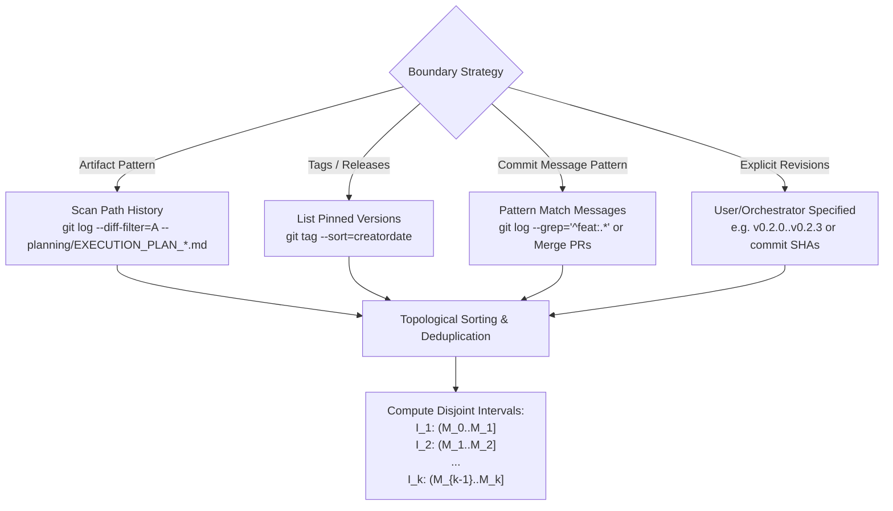
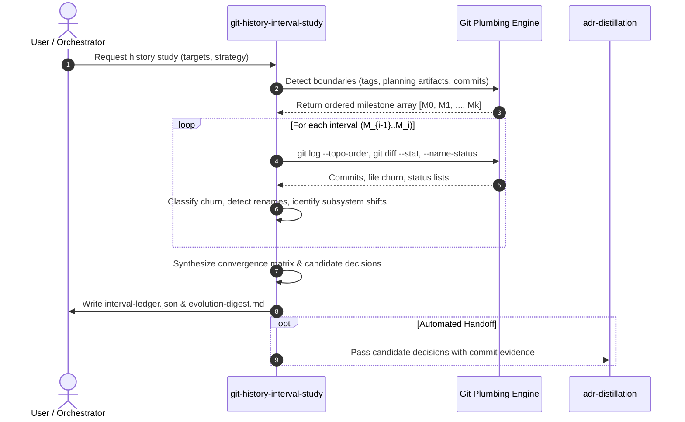

# Research Report: Git History Interval Study Skill (`git-history-interval-study`)

## Executive Summary

This report establishes the architectural specification, git plumbing/porcelain foundations, interval boundary detection heuristics, and structured interface contracts for a new skill: `git-history-interval-study` (or `git-evolution-digest`).

Modern agent workflows operate across discrete development intervals—such as milestone releases, tagged versions, or orchestration plan iterations (`planning/EXECUTION_PLAN_N.md`, `planning/STATE_N.md`). While existing skills like `plan-wave` and `wave-orchestration` manage forward execution, and `adr-distillation` formalizes enduring architectural decisions, a critical gap exists in systematically analyzing and synthesizing what transpired between milestone boundaries across version control history.

`git-history-interval-study` fills this gap by:
1. Identifying boundary markers across git history using topological ordering, path pattern matching (e.g. `planning/EXECUTION_PLAN_*.md`), release tags, or milestone commits.
2. Slicing repository history into sequential revision ranges (`rev_prev..rev_curr`) and extracting mechanical diffs, file churn metrics, commit classifications, and architectural refactorings.
3. Tracing component evolution and conceptual convergence across multiple intervals.
4. Emitting machine-readable ledgers (`interval-ledger.json`) and human-readable digests (`evolution-digest.md`) that directly feed downstream skills, specifically `adr-distillation`, documentation generators, and architectural review audits.

---

## 1. Git Plumbing and Porcelain Foundations for Interval Study

To achieve reproducible, deterministic historical analysis across complex repositories containing branches, merge commits, and squashes, the skill relies on specific Git plumbing and porcelain tools.

### 1.1 Revision Range Semantics & Boundary Math

A core vulnerability in git analysis is selecting inappropriate revision range syntax:

- **Two-Dot Range (`A..B`)**: Computes reachable commits from $B$ excluding commits reachable from $A$, defined as `^A B`. In linear history or simple branch integration, this precisely isolates the work added between boundary $A$ and milestone $B$.
- **Merge Base Handling (`A...B`)**: Computes symmetric difference (`(A OR B) AND NOT (A AND B)`). For interval study, three-dot notation is useful when analyzing diverging feature branches before merge, but two-dot range `rev_prev..rev_curr` is the canonical interval definition for sequential milestones.
- **Merge Base Resolution**: When comparing two arbitrarily branched points $A$ and $B$, the true divergence point is found via:
  ```bash
  git merge-base A B
  ```
- **Topological Ordering**: History must be traversed chronologically or reverse-chronologically without interleaving unrelated branches.
  ```bash
  git log --topo-order --reverse rev_prev..rev_curr
  ```
  `--topo-order` prevents commits from different branches from being mixed together purely by commit author timestamp (which can be skewed or non-monotonic).
- **First-Parent Traversal (`--first-parent`)**: When examining mainline/trunk history where merge commits represent complete wave orchestrations or pull requests:
  ```bash
  git log --first-parent --oneline rev_prev..rev_curr
  ```
  This treats merge commits as atomic milestone transitions, filtering out intermediate task-level worker commits if high-level interval views are desired.

### 1.2 Boundary Detection Plumbing

To determine exactly when artifacts of interest (such as `planning/EXECUTION_PLAN_*.md` or specific configuration files) were introduced, modified, or retired:

1. **Path Addition Filter (`--diff-filter=A`)**:
   Locates the exact commit introducing a specific file:
   ```bash
   git log --diff-filter=A --format="%H %ct %s" -- "planning/EXECUTION_PLAN_*.md"
   ```
2. **Pickaxe Search (`-S<string>` and `-G<regex>`)**:
   - `git log -S<string>`: Finds commits where the count of occurrences of `<string>` changed in the diff. Ideal for discovering when specific API contracts or architectural tokens were introduced.
   - `git log -G<regex>`: Finds commits where the patch contains lines matching `<regex>`.
3. **Name and Status Inspection (`--name-status`)**:
   Plumbing-grade summary of file changes without pulling full diff text into agent context:
   ```bash
   git log --name-status --oneline rev_prev..rev_curr
   ```
   Outputs status letters: `A` (Added), `M` (Modified), `D` (Deleted), `R` (Renamed with similarity percentage), `C` (Copied).
4. **Diff Stat and Summary (`--stat`, `--shortstat`)**:
   Provides line-level churn metrics:
   ```bash
   git diff --stat=120,80 rev_prev..rev_curr
   git diff --shortstat rev_prev..rev_curr
   ```
5. **Raw Tree Diffs (`git diff-tree`)**:
   Plumbing command that operates directly on tree SHAs, bypassing working directory status:
   ```bash
   git diff-tree -r --no-commit-id --name-status rev_prev rev_curr
   ```

---

## 2. Interval Boundary Detection Strategies

An interval study requires identifying ordered milestone markers $M_0, M_1, M_2, \dots, M_k$ that partition the commit graph into intervals $I_j = [M_{j-1}, M_j]$.

The skill provides three configurable boundary detection strategies:



### 2.1 Strategy A: Artifact Lifecycle Markers (Wave / Planning Artifacts)
For repositories employing `plan-wave` and `wave-orchestration`, planning files represent the canonical boundary of an architectural wave.
- **Target pattern**: `planning/EXECUTION_PLAN_*.md`, `planning/STATE_*.md`, or `planning/PROMPT_TEMPLATE_*.md`.
- **Plumbing**:
  ```bash
  git log --diff-filter=A --format="%H|%ad|%s" --date=iso-strict -- "planning/EXECUTION_PLAN_*.md"
  ```
- **Fallback for untracked/gitignored planning dirs**: If `planning/` is gitignored in the current repo (as in `aigb-skills-usda`), the skill falls back to:
  1. Commit subject patterns referring to plan completions (e.g. `feat(plan-wave): ...`, `chore(planning): ...`).
  2. Local disk artifact mtime/creation boundaries if studying uncommitted local waves.
  3. Sibling commit detection where corresponding source changes were committed.

### 2.2 Strategy B: Git Tags and Release Milestones
Ideal for studying version-to-version semantic releases:
- **Plumbing**:
  ```bash
  git tag --sort=creatordate --format="%(objectname)|%(refname:short)|%(creatordate:iso-strict)|%(subject)"
  ```
- Generates natural intervals: `v0.1.0..v0.2.0`, `v0.2.0..v0.2.1`, `v0.2.1..v0.2.2`, `v0.2.2..v0.2.3`.

### 2.3 Strategy C: Mainline Merge Commits (First-Parent Milestones)
When trunk-based development uses squash merges or PR merge commits to mark feature completions:
- **Plumbing**:
  ```bash
  git log --first-parent --merges --format="%H|%cd|%s" --date=iso-strict main
  ```
- Isolates every PR landing as a discrete interval.

### 2.4 Strategy D: Explicit Arbitrary Range
Allows ad-hoc investigation by the user or an orchestrating agent:
- Accepts revision range strings: `HEAD~20..HEAD`, `feat-branch-a..feat-branch-b`, or an explicit list of SHAs `[sha1, sha2, sha3]`.

---

## 3. Feature Tracking and Convergence Heuristics

Once intervals $I_1, I_2, \dots, I_k$ are extracted, the skill inspects how features, subsystems, and architectural concepts evolve across intervals.

### 3.1 Churn and Volatility Metrics
Files exhibiting high edit frequency across successive intervals signify unstable interfaces or architectural convergence hot spots:
- **Interval Churn Index ($C_i$)**:
  $$C_i(F) = \text{lines\_added}_i(F) + \text{lines\_deleted}_i(F)$$
- **Cumulative Churn across Intervals**: A module that shows high churn in $I_1$ and $I_2$, but stabilizes to minimal churn with zero API changes in $I_3$ indicates architectural convergence.
- High churn persisting across all intervals indicates technical debt or lack of separation of concerns.

### 3.2 Commit Type Distribution (Conventional Commits)
By categorizing commits within each interval according to Conventional Commits (`feat`, `fix`, `refactor`, `chore`, `docs`, `test`):
- **Phase 1 of a subsystem**: Dominated by `feat`, file additions (`A`), and structural additions.
- **Phase 2 (Refinement)**: Rise in `test`, `fix`, and rename/move operations (`R`).
- **Phase 3 (Convergence)**: Dominated by `refactor`, `docs`, and reduction in net lines of code.

### 3.3 Semantic Subsystem Tracing
To track a specific architectural component (e.g., `sync-skills`, `catalog`, or `validator`) across intervals without full AST dependencies:
1. **Directory / Path Anchors**:
   Filter diffs by path scope:
   ```bash
   git log --name-status rev_prev..rev_curr -- scripts/sync-skills.js
   ```
2. **Symbol / Token Tracking**:
   Track the introduction, mutation, and retirement of export symbols or functions via pickaxe search (`-S`):
   ```bash
   git log -S "parseSimpleYamlFrontmatter" --oneline rev_prev..rev_curr
   ```
3. **Renames and Structural Movement**:
   Detect renames with similarity indexing (`-M`):
   ```bash
   git diff -M --summary rev_prev rev_curr
   ```
   Ensures that an architectural component moving from `src/` to `lib/` or `skills/*/` is recognized as an evolution rather than a deletion + unrelated creation.

---

## 4. Interface and Output Contract

To seamlessly integrate with `adr-distillation` and developer tooling, `git-history-interval-study` produces two standardized artifacts:
1. `interval-ledger.json`: Machine-readable, structured ledger of all intervals, metrics, and file changes.
2. `evolution-digest.md`: Human- and LLM-readable narrative report outlining subsystem evolution, convergence patterns, and candidate architectural decisions.

### 4.1 Schema: `interval-ledger.json`

```json
{
  "$schema": "https://json-schema.org/draft/2020-12/schema",
  "meta": {
    "generated_at": "2026-10-12T05:00:00Z",
    "generator": "git-history-interval-study",
    "repository": "aigb-skills-usda",
    "boundary_strategy": "tags",
    "interval_count": 3
  },
  "intervals": [
    {
      "interval_id": "int-01",
      "name": "v0.2.0..v0.2.1",
      "boundary_start": {
        "ref": "v0.2.0",
        "commit": "05b9808d44747db85f694e82b7b5c8734208034a",
        "date": "2026-09-25T14:10:00Z"
      },
      "boundary_end": {
        "ref": "v0.2.1",
        "commit": "05f2918fac6dedae541b41a243fdc62ba7903dc2",
        "date": "2026-10-02T13:44:58Z"
      },
      "summary": {
        "commits_count": 8,
        "files_changed": 15,
        "insertions": 340,
        "deletions": 85,
        "commit_types": {
          "feat": 3,
          "fix": 2,
          "chore": 2,
          "docs": 1
        }
      },
      "subsystem_churn": [
        {
          "subsystem": "planning",
          "paths": ["skills/plan-wave/SKILL.md", "planning/TODO20260925.md"],
          "net_lines": -20,
          "classification": "refactor"
        },
        {
          "subsystem": "vendoring",
          "paths": ["skills/caveman/SKILL.md", "skills/ponytail/SKILL.md"],
          "net_lines": 180,
          "classification": "feature-addition"
        }
      ],
      "architectural_signals": [
        "Explicit numbering introduced for plan-wave artifacts (EXECUTION_PLAN_N.md)",
        "Cleanup of ephemeral planning files from version control",
        "Vendoring of external utility skills"
      ]
    }
  ],
  "convergence_matrix": {
    "subsystems": {
      "skills-metadata": {
        "int-01": "Unstructured top-level yaml",
        "int-02": "Nested metadata contract introduced and tested",
        "int-03": "Preserved during sync and aliased cleanly",
        "status": "converged"
      },
      "planning-artifacts": {
        "int-01": "Numbered scheme adopted (v1.1)",
        "int-02": "Planning directory gitignored",
        "int-03": "Stable",
        "status": "converged"
      }
    }
  }
}
```

### 4.2 Template: `evolution-digest.md`

```markdown
# Architectural Evolution Digest: [Repository Name]

**Analysis Range:** `[Start Ref]` $\rightarrow$ `[End Ref]`  
**Interval Boundary Mode:** `[Tags | Planning Artifacts | Custom Revisions]`  
**Total Intervals Studied:** `[Count]`

---

## 1. Executive Timeline & Milestone Ledger

| Interval | Boundary Range | Commits | Churn (+ / -) | Primary Focus / Milestone Theme |
|---|---|---|---|---|
| I-1 | `v0.2.0..v0.2.1` | 8 | +340 / -85 | Numbered wave plans & external skill vendoring |
| I-2 | `v0.2.1..v0.2.2` | 10 | +420 / -110 | Skill frontmatter metadata normalization & testing |
| I-3 | `v0.2.2..v0.2.3` | 7 | +85 / -22 | CLI command documentation & alias preservation |

---

## 2. Cross-Interval Subsystem Evolution Matrix

| Subsystem / Area | Interval 1 | Interval 2 | Interval 3 | Convergence State |
|---|---|---|---|---|
| **Skill Metadata Contract** | Inconsistent top-level fields | Refactored into nested `metadata.*` with strict schema validation | Aliases supported; sync scripts retain nested keys | **Converged** |
| **Validation Engine** | Initial CI test script | Added schema tests for metadata | Stable | **Converged** |
| **Wave Planning** | Adopted `PLAN_N` convention | Cleaned up root `planning/` artifacts | Maintained via gitignore | **Converged** |

---

## 3. Detailed Interval Breakdowns

### Interval 1: `v0.2.0..v0.2.1`
- **Key Architectural Shifts**:
  - `skills/plan-wave/SKILL.md`: Upgraded to v1.1, formalizing `EXECUTION_PLAN_N.md` and `STATE_N.md` numbering scheme.
  - Ephemeral planning files removed from source control, moving toward state-on-disk runtime isolation.
- **Notable Commits**:
  - `3df38ef`: *feat(skill): plan-wave v1.1 - explicit planning artifact numbering for clarity*
  - `83e233e`: *chore: cleanup planning/*
- **ADR Distillation Feed**:
  - Candidate Decision: *Adopt numbered sequential filenames for orchestration planning artifacts.*

*(Repeated for each interval)*

---

## 4. Feed for Downstream Skills (`adr-distillation`)

The following candidate decisions exhibit architectural significance, high reversal cost, or structural convention setting:
1. **Decision Candidate 1**: Schema nesting for repository metadata in curated skills (`metadata.*`).
   - *Evidence Commits*: `3dea55f`, `46e0b1e`, `a7eb918`.
   - *Forces*: Separation between public skill definition and repo synchronization plumbing.
2. **Decision Candidate 2**: Offline-first packaged skill installation without upstream git checkouts.
   - *Evidence Commits*: `05b9808`.
```

---

## 5. Proposed Skill Specification: `git-history-interval-study`

### 5.1 Frontmatter Specification
```yaml
---
name: git-history-interval-study
description: Analyzes git repository history across configurable intervals (tagged releases, wave planning artifacts, or commit milestones). Extracts diff churn, commit classifications, subsystem evolution, and architectural convergence to feed ADR distillation and architecture documentation.
license: MIT
metadata:
  version: 1.0
  author: Andrew G. Brown (https://github.com/brownag)
  source_repo: aigb-skills-usda
  source_path: skills/git-history-interval-study/SKILL.md
---
```

### 5.2 Workflow Phases



#### Phase 1: Boundary Resolution & Interval Setup
- Accepts parameters:
  - `--strategy`: `planning-artifacts` | `tags` | `merges` | `range`
  - `--pattern`: e.g. `planning/EXECUTION_PLAN_*.md` (for artifact strategy)
  - `--range`: e.g. `v0.1.0..HEAD`
  - `--output-dir`: defaults to `docs/history/` or `.scratch/`
- Runs git plumbing to establish the strict array of boundary commits: `[C_0, C_1, ..., C_n]`.

#### Phase 2: Quantitative Extraction per Interval
For each range `C_{j-1}..C_j`:
- `git log --topo-order --format="%H|%an|%ad|%s" C_{j-1}..C_j`
- `git diff --shortstat C_{j-1} C_j`
- `git diff --name-status -M C_{j-1} C_j`
- Aggregates file churn by subsystem/module prefix (e.g. `skills/`, `scripts/`, `planning/`, `docs/`).

#### Phase 3: Qualitative Pattern Analysis & Convergence Tracking
- Categorizes commit messages using Conventional Commits.
- Tracks recurring file edits across intervals:
  - Files edited in 3+ consecutive intervals $\rightarrow$ "High churn / evolving interface".
  - Files heavily edited then unedited $\rightarrow$ "Stabilized / converged component".
- Extracts architectural rationale from merge PR bodies or detailed commit descriptions.

#### Phase 4: Output Synthesis & Downstream Dispatch
- Formats `interval-ledger.json` and `evolution-digest.md`.
- Highlights candidate architectural decisions with exact commit citations.
- Prepares structured input payload for `adr-distillation`.

---

## 6. Concrete Command Patterns & CLI Helpers

The skill combines standard Git commands with a lightweight Node.js helper pattern (or pure shell script) to ensure zero third-party dependencies:

### 6.1 Pure Git Command Recipes

```bash
# 1. Discover commits that introduced planning execution plans
git log --diff-filter=A --format="%H %as %s" -- "planning/EXECUTION_PLAN_*.md" | sort -k2

# 2. Extract commit subjects and status for an interval
git log --topo-order --reverse --format="* %h (%as): %s" rev1..rev2

# 3. File status breakdown with rename detection
git diff --name-status -M rev1 rev2

# 4. Churn by top-level directory
git diff --numstat rev1 rev2 | awk -F'\t' '{
  split($3, path, "/");
  dir = path[1];
  added[dir] += $1;
  deleted[dir] += $2;
} END {
  for (d in added) printf "%-20s +%-6d -%-6d\n", d, added[d], deleted[d];
}'

# 5. Check if a symbol or token was modified in an interval
git log -S "syncCuratedSkills" -p rev1..rev2
```

### 6.2 Lightweight Study Script (`scripts/study-history-intervals.js`)
A minimal Node.js helper can automate the boundary resolution and JSON ledger creation without external dependencies (analogous to `scripts/mine-history.js`):
- Queries git via `child_process.execFileSync`.
- Parses `--name-status` and `--shortstat`.
- Emits standard `interval-ledger.json`.

---

## 7. Downstream Synergy with `adr-distillation`

In `docs/research/adr-distillation-skill.md`, the primary challenge identified is:
> *"Context Compaction... Once an orchestration completes or is cleaned up, the rich rationale in EXECUTION_PLAN_N.md and unexpected architectural deviations discovered in STATE_N.md are easily lost..."*

By pairing `git-history-interval-study` with `adr-distillation`:
1. **Retroactive Recovery**: When wave planning files were gitignored or cleared, `git-history-interval-study` reconstructs the boundary points from commit history and PR merge points, identifying the architectural decisions that landed in code.
2. **Evidence Backing**: Every proposed ADR gains an **Evidence Matrix** linking decisions to exact git ranges, commits, and diff stats.
3. **Continuous ADR Audit**: As new intervals are studied, the convergence heuristics automatically flag when an existing ADR is being violated or superseded by code changes.

---

## 8. Recommendations and Implementation Roadmap

1. **Adopt Skill Name**: `git-history-interval-study`.
   - Clear, descriptive, and mirrors unix/git conventions.
2. **Placement**:
   - Skill spec: `skills/git-history-interval-study/SKILL.md`.
   - Reference documentation and scripts: `skills/git-history-interval-study/references/boundary-strategies.md` and `skills/git-history-interval-study/scripts/interval_ledger.js`.
3. **Implement in aigb-skills-usda**:
   - Incorporate into the curated skill catalog alongside `adr-distillation`, `plan-wave`, and `wave-orchestration`.
   - Update `AGENTS.md` to list `git-history-interval-study` as the standard mechanism for historical repo recon.

---

## 9. Primary References

- **Git Reference Documentation**:
  - `git-log(1)`: Revision range options (`..`, `...`), `--topo-order`, `--first-parent`, `--diff-filter`.
  - `git-diff(1)`: `--stat`, `--numstat`, `--name-status`, `-M` rename detection.
  - `git-merge-base(1)`: Divergence point computation.
- **Repository Artifacts (`aigb-skills-usda`)**:
  - `docs/research/adr-distillation-skill.md`: Architecture decision distillation specification.
  - `skills/plan-wave/SKILL.md`: Planning artifact numbering (`EXECUTION_PLAN_N.md`).
  - `skills/wave-orchestration/SKILL.md`: Task-level execution and disk state conventions.
  - `scripts/mine-history.js`: Catalog extraction and frontmatter mining precedent.
