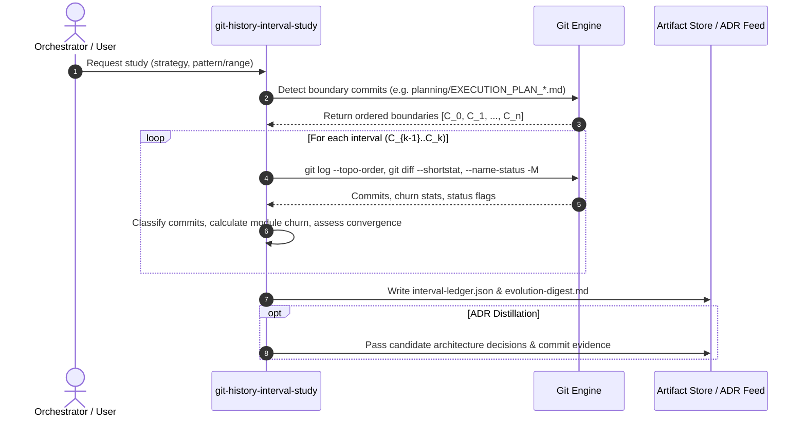

# Git History Interval Study

Provides a structured mechanism for studying repository history between marked intervals of interest - such as when new orchestration plans (`planning/EXECUTION_PLAN_N.md`), tags, or architectural milestones are created.

By systematically inspecting sequential diffs, commit classifications, and component churn between intervals, this skill identifies features as they develop and are refined over time, gauges architectural convergence, and provides evidence matrices for downstream skills like `adr-distillation`.

---

## 1. When to Use This Skill

- **Wave / Plan Transitions**: When tracking architectural changes between successive wave orchestration plans (`EXECUTION_PLAN_1.md` -> `EXECUTION_PLAN_2.md` -> etc.).
- **Milestone & Release Evolution**: When analyzing code churn and feature development across Git tags or release branches.
- **Architectural Decision Synthesis**: When providing structured, evidence-backed input to `adr-distillation` to document why design decisions were made and how components stabilized.
- **Subsystem & Interface Stabilization**: When checking if a module has converged (diminishing churn, test stabilization) or remains volatile.

---

## 2. Core Concepts & Interval Math

An **Interval** is a revision slice bounded by two milestone commits: $I_k = [C_{k-1}, C_k]$.

### Revision Range Plumbing
- **Sequential Revision Range (`A..B`)**: Evaluates all commits reachable from $B$ excluding those reachable from $A$ (`^A B`).
- **Topological Ordering (`--topo-order`)**: Ensures parent commits precede children regardless of commit author timestamps across concurrent branches.
- **First-Parent Traversal (`--first-parent`)**: Useful for trunk-based repositories with merge commits, treating each merge as an atomic interval step.
- **Rename Detection (`-M`)**: Resolves file renames and structural moves so code churn reflects genuine edits rather than deletions + additions.

---

## 3. Workflow Phases



### Phase 1: Boundary Resolution

Select a boundary strategy based on the repository structure:

1. **Strategy A (Artifact Creation - e.g. Planning Files)**:
   Finds commits where key tracking or plan files were added:
   ```bash
   git log --diff-filter=A --format="%H|%as|%s" -- "planning/EXECUTION_PLAN_*.md" | sort -t'|' -k2
   ```
2. **Strategy B (Version Tags)**:
   Extracts chronological tags:
   ```bash
   git tag --sort=creatordate
   ```
3. **Strategy C (Mainline Merges / PRs)**:
   Identifies merge commits on the primary branch:
   ```bash
   git log --first-parent --merges --format="%H|%as|%s"
   ```
4. **Strategy D (Explicit Revisions)**:
   Accepts user-specified commit SHAs or branch ranges (e.g. `v0.1.0..v0.2.0`).

### Phase 2: Quantitative Interval Extraction

For each adjacent pair $[C_{k-1}, C_k]$:

1. **Commit Log Extraction**:
   ```bash
   git log --topo-order --reverse --format="%h|%an|%as|%s" C_{k-1}..C_k
   ```
2. **High-Level Churn Metrics**:
   ```bash
   git diff --shortstat C_{k-1} C_k
   ```
3. **File-Level Status with Rename Tracking**:
   ```bash
   git diff --name-status -M C_{k-1} C_k
   ```
4. **Subsystem Directory Aggregation**:
   Aggregate line churn by module directory (`skills/`, `src/`, `scripts/`, `docs/`, `planning/`).

### Phase 3: Qualitative Analysis & Convergence Tracking

1. **Commit Type Breakdown**:
   Classify commit messages using Conventional Commits (`feat`, `fix`, `refactor`, `test`, `docs`, `chore`, `perf`).
2. **Convergence Heuristic**:
   - **Volatile / Divergent**: High addition/deletion churn ($C_i = L_{add} + L_{del}$), frequent changes to interfaces and public signatures, high ratio of `feat` and `refactor` commits.
   - **Stabilizing / Converging**: Diminishing churn over intervals, stable API boundaries, transition to `test`, `fix`, and `docs` commits.
3. **Pickaxe Symbol Tracking (`git log -S`)**:
   Verify when specific classes, functions, or architectural patterns were added or adapted across intervals:
   ```bash
   git log -S "<symbol-name>" -p C_{k-1}..C_k
   ```

### Phase 4: Output Synthesis & Downstream Handoff

Emit two structured outputs:

1. **`interval-ledger.json`**: Machine-readable JSON summary capturing boundaries, commit SHAs, file lists, churn numbers, and convergence classifications.
2. **`evolution-digest.md`**: Markdown narrative document summarizing:
   - Interval Overview & Timeline
   - Subsystem Evolution Matrix
   - Feature additions and refinements
   - Emergent architectural shifts & trade-offs
   - **Feed for `adr-distillation`**: Candidate decisions with exact commit citations and evidence diffs.

---

## 4. Helper Script Usage

A zero-dependency Node.js script is included in `scripts/interval_ledger.js`:

```bash
# Analyze intervals based on planning execution plans
node skills/git-history-interval-study/scripts/interval_ledger.js --pattern "planning/EXECUTION_PLAN_*.md" --out .scratch/

# Analyze intervals based on git tags
node skills/git-history-interval-study/scripts/interval_ledger.js --tags --out docs/history/

# Analyze an explicit commit or release range
node skills/git-history-interval-study/scripts/interval_ledger.js --range v0.2.0..HEAD --out .scratch/
```

---

## 5. Downstream Integration with `adr-distillation`

When paired with `adr-distillation`, the interval study serves as the authoritative evidence gatherer:
- Connects high-level planning decisions in `EXECUTION_PLAN_N.md` with the concrete commits that implemented them.
- Identifies unrecorded emergent architectural changes that occurred between plan milestones.
- Supplies exact commit SHAs, author dates, and file diffs for ADR "Context", "Decision", and "Consequences" sections.
